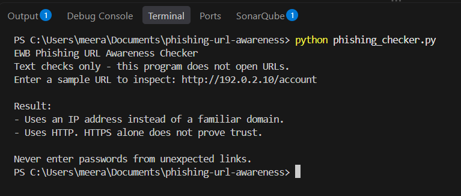
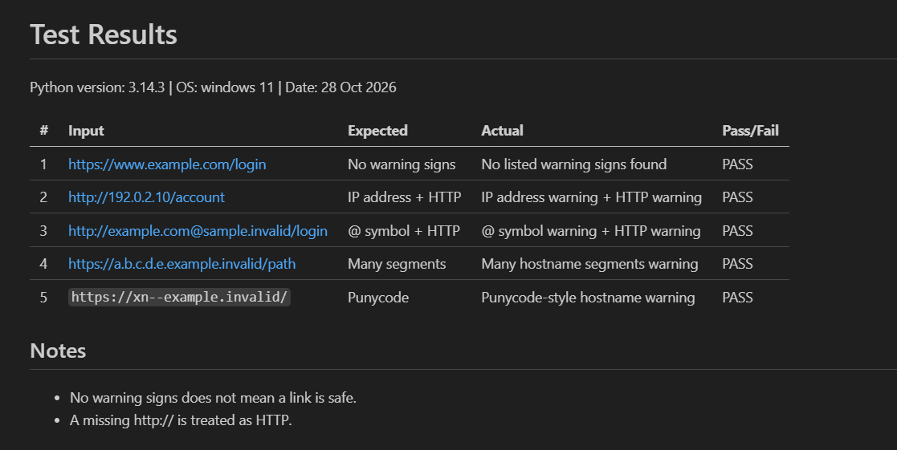

# EWB Phishing URL Awareness Checker

## Overview
Phishing is a trick where criminals send fake links to steal passwords, card numbers or OTPs. This tool reads a URL as plain text and lists simple warning signs, like an IP address or an @ symbol. It never opens the link.
1. **Loop with quit** - The original program checked one URL and closed. I added a while loop so users can check many URLs in one run and type q to quit. I tested it by entering several URLs in a row, then typing q.
2. **Malformed input handling** - Typing http://[bad crashed the program with a ValueError. I wrapped the urlparse line in try/except so it now prints "This text is not a valid URL format." I tested it by typing http://[bad and re-running all five sample tests.
## Features
- Detects an @ symbol in the URL
- Flags unusually long URLs (over 100 characters)
- Flags IP-address hostnames
- Flags many hostname segments (5 or more)
- Flags punycode-style hostnames (xn--)
- Flags the HTTP scheme
- Loop mode: check many URLs, type q to quit
- Handles malformed input without crashing

## Requirements
Python 3.10 or later. No extra packages.

## How to Run
Windows: `python phishing_checker.py`
Mac/Linux: `python3 phishing_checker.py`

## Example Output
```
Result:
- Uses an IP address instead of a familiar domain.
- Uses HTTP. HTTPS alone does not prove trust.
```

## Testing
| # | Input | Expected | Actual | Result |
|---|-------|----------|--------|--------|
| 1 | `https://www.example.com/login` | No warning signs | No listed warning signs found | PASS |
| 2 | `http://192.0.2.10/account` | IP address + HTTP | IP address + HTTP warnings | PASS |
| 3 | `http://example.com@sample.invalid/login` | @ symbol + HTTP | @ symbol + HTTP warnings | PASS |
| 4 | `https://a.b.c.d.e.example.invalid/path` | Many segments | Many hostname segments warning | PASS |
| 5 | `https://xn--example.invalid/` | Punycode | Punycode-style hostname warning | PASS |

Full table: `tests/test_samples.md`

## Screenshots



## Improvements
1. **Loop with quit** - [what changed, why, how you tested it]
2. **Malformed input handling** - [what changed, why, how you tested it]

## Limitations
This is an educational tool. It only reads URL text. It does not visit
URLs, scan for malware or prove that a URL is safe. No warning signs
found does NOT mean a URL is safe.

## Ethical Use
Use sample strings only. Do not collect credentials. Do not use this
project to deceive anyone or to test websites without permission.

## Author
Name: Adnan Akbar Mir, 
Cybersecurity internship, 
EWB Courses